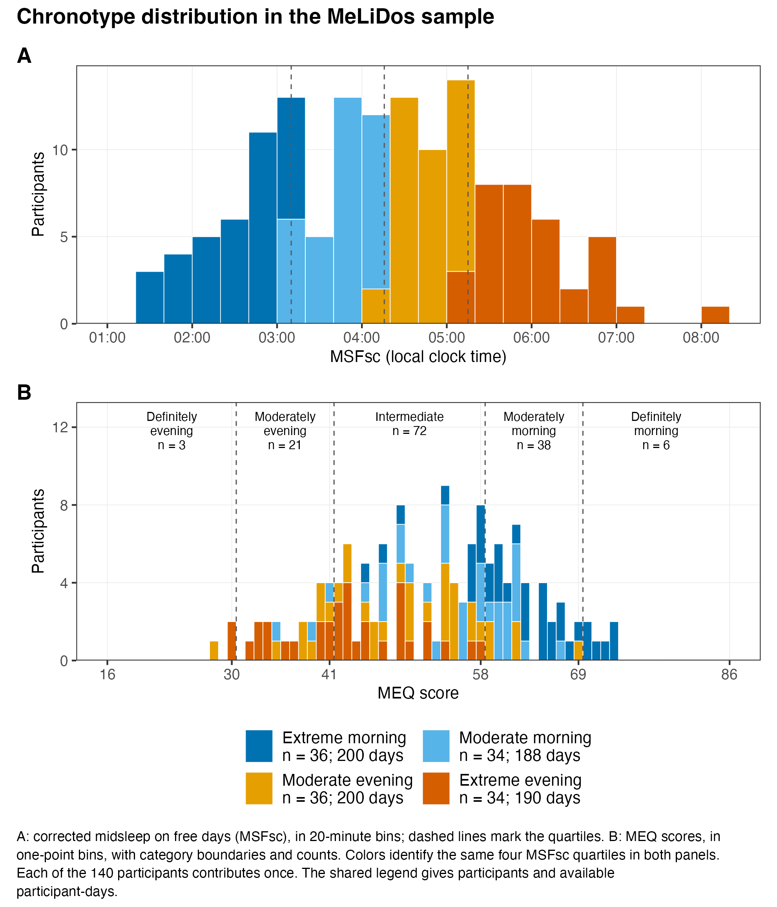
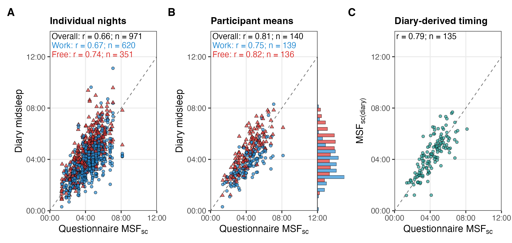
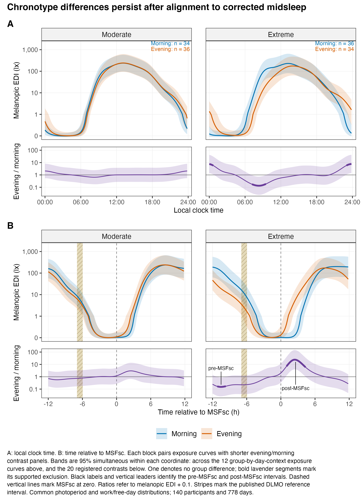
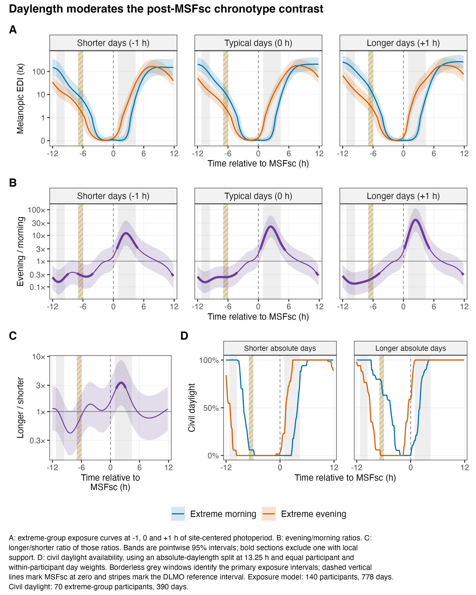
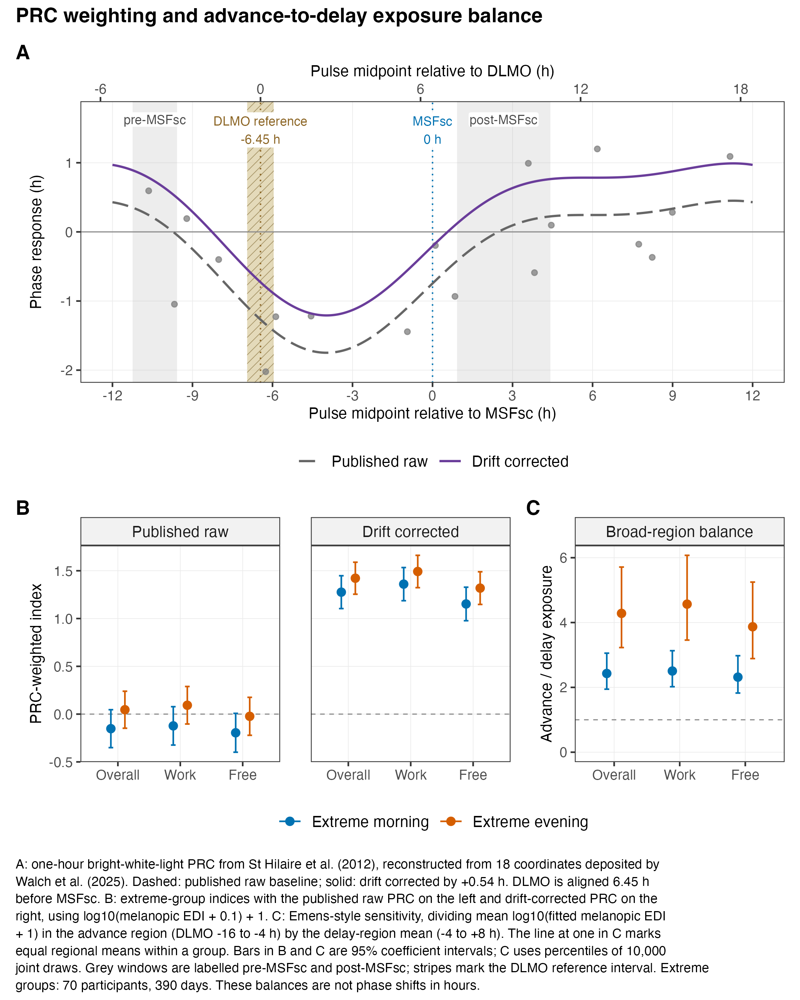

These five figures accompany the [manuscript](index.qmd). The four exposure-analysis composites have manuscript and standalone versions, available as 300 dpi PNGs and vector PDFs. The diary comparison is available as a 220 dpi PNG and vector PDF. Select an image to enlarge it.

## Figure 1: Chronotype distributions

The same 140 participants appear in the MSFsc and MEQ histograms. MSFsc uses 20-minute bins; colors identify the four MSFsc quartiles in both panels.

| Version | PNG | PDF |
|:--|:--|:--|
| Manuscript | [Download PNG](results/figures/manuscript/figure-1-chronotypes.png) | [Download PDF](results/figures/manuscript/figure-1-chronotypes.pdf) |
| Standalone | [Download PNG](results/figures/manuscript/figure-1-chronotypes-standalone.png) | [Download PDF](results/figures/manuscript/figure-1-chronotypes-standalone.pdf) |

{fig-alt="Two histograms show corrected free-day midsleep and MEQ scores. Four colors identify the same MSFsc quartiles, with category boundaries and participant counts."}

## Figure 2: Diary sleep timing and MSFsc

Individual nights, participant means and diary-derived corrected midsleep are compared with questionnaire MSFsc. Work/free-day correlation labels match the Solarized point colors. The marginal histogram attached to panel B uses offset half-width bars within common 30-minute bins.

[Download PNG](results/figures/sleep_diary_scatter.png) · [Download PDF](results/figures/sleep_diary_scatter.pdf)

{fig-alt="Three panels compare individual diary nights, participant means and diary-derived corrected midsleep with questionnaire MSFsc. Overall correlations are 0.66, 0.81 and 0.79. Blue work-day and red free-day symbols have black outlines; a marginal histogram sits against panel B's right edge."}

## Figure 3: Exposure patterns and group contrasts

Each exposure panel has its evening/morning contrast directly underneath. A uses local clock time; B uses time relative to corrected midsleep. The contrast panels are half the height of the exposure panels.

| Version | PNG | PDF |
|:--|:--|:--|
| Manuscript | [Download PNG](results/figures/manuscript/figure-2-patterns.png) | [Download PDF](results/figures/manuscript/figure-2-patterns.pdf) |
| Standalone | [Download PNG](results/figures/manuscript/figure-2-patterns-standalone.png) | [Download PDF](results/figures/manuscript/figure-2-patterns-standalone.pdf) |

{fig-alt="Morning-type and evening-type exposure patterns appear above their ratios, in clock time and relative to MSFsc. Black labels and vertical leaders identify the significant pre-MSFsc and post-MSFsc intervals. Morning types have higher exposure pre-MSFsc; evening types have higher exposure post-MSFsc."}

## Figure 4: Daylength and solar timing

Panels A and B compare photoperiod targets of −1, 0 and +1 hours relative to the site mean. C shows the longer/shorter-day change in the extreme-group ratio. D shows civil daylight availability, using the separate absolute-daylength comparison. Grey intervals mark the primary exposure differences; dashed vertical lines mark MSFsc at zero and stripes mark the DLMO reference interval.

| Version | PNG | PDF |
|:--|:--|:--|
| Manuscript | [Download PNG](results/figures/manuscript/figure-3-daylength.png) | [Download PDF](results/figures/manuscript/figure-3-daylength.pdf) |
| Standalone | [Download PNG](results/figures/manuscript/figure-3-daylength-standalone.png) | [Download PDF](results/figures/manuscript/figure-3-daylength-standalone.pdf) |

{fig-alt="Four panels combine extreme-group exposure, evening/morning ratios, daylength moderation and civil daylight. Bold sections identify supported pointwise differences; the later group contrast increases on longer days."}

## Figure 5: Phase-response weighting

The reconstructed one-hour light PRC is anchored to DLMO and MSFsc above the weighted exposure indices and the Emens-style advance/delay sensitivity. Grey intervals identify the pre-MSFsc and post-MSFsc exposure differences. The weighted indices show the published raw PRC first, followed by the drift-corrected PRC. Only the extreme chronotype groups are shown.

| Version | PNG | PDF |
|:--|:--|:--|
| Manuscript | [Download PNG](results/figures/manuscript/figure-4-prc.png) | [Download PDF](results/figures/manuscript/figure-4-prc.pdf) |
| Standalone | [Download PNG](results/figures/manuscript/figure-4-prc-standalone.png) | [Download PDF](results/figures/manuscript/figure-4-prc-standalone.pdf) |

{fig-alt="Raw and drift-corrected phase-response curves appear above extreme-group weighted indices for overall, work and free days. Evening estimates are higher at the central alignment, while direct group contrasts remain uncertain."}

## Source mapping

| Manuscript | Analysis supplement |
|:--|:--|
| Figure 1 | [Figure 1: chronotype distributions](analysis.qmd#fig-chronotype-distributions) |
| Figure 2 | [Diary sleep timing comparison](analysis.qmd#fig-sleep-diary-scatter) |
| Figure 3 | [Overall patterns](analysis.qmd#fig-patterns-overall), [overall contrasts](analysis.qmd#fig-direction-differences) |
| Figure 4 | [Daylength patterns](analysis.qmd#fig-daylight-patterns), [group ratios](analysis.qmd#fig-daylight-ratios), [moderation](analysis.qmd#fig-daylight-moderation) and [civil daylight availability](analysis.qmd#fig-daylight-civil-availability) |
| Figure 5 | [PRC](analysis.qmd#fig-phase-response-kernel) and [weighted indices](analysis.qmd#fig-phase-response-indices) |

The [figure composition script](R/build_manuscript_figures.R) uses saved numerical outputs. It also exports the plotted data and records source checksums and package versions.
