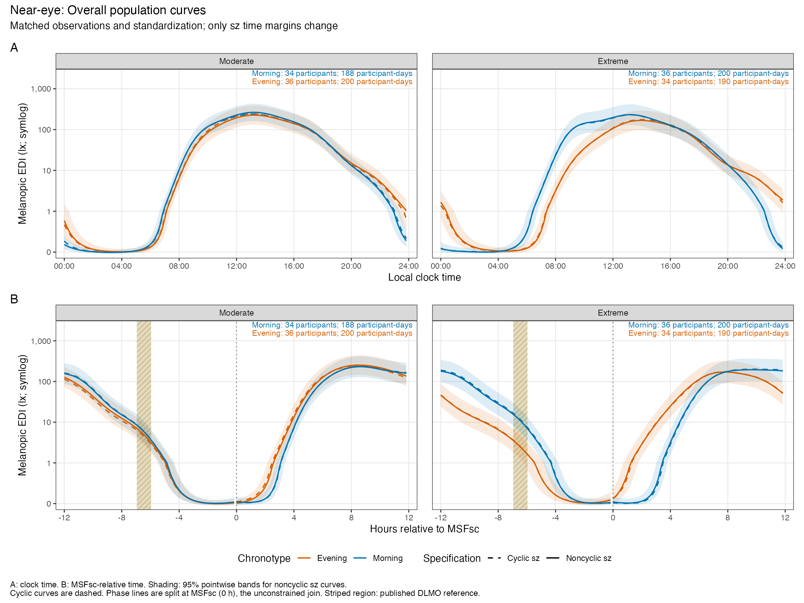
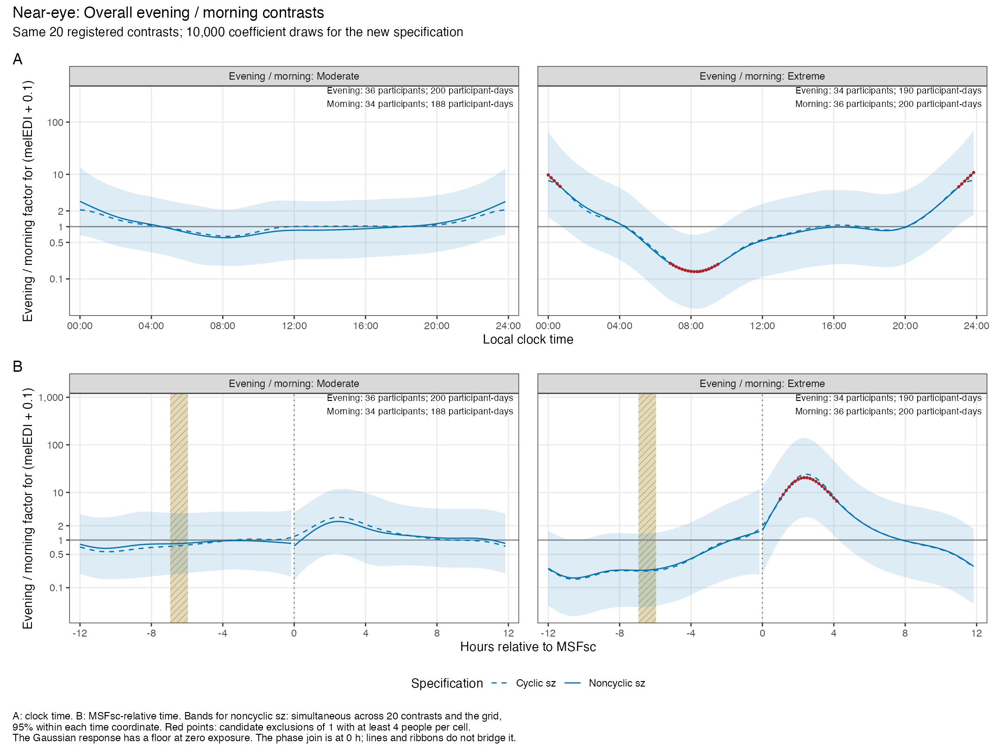

This notebook compares the primary chronotype models with a sensitivity that retains the cyclic shared daily curve and makes the group and site deviations noncyclic. The sample, response, photoperiod adjustment, participant curves, participant-day intercepts, and elapsed-time ordering are the same. The question is whether changing this one modelling choice materially changes the fitted daily patterns and evening-versus-morning contrasts.

The fitted patterns and in-sample R² change little. For extreme chronotypes, the larger evening/morning factor after MSFsc remains in both specifications. The earlier candidate interval, around 9.6–11.3 hours before MSFsc, no longer excludes a factor of 1 with the noncyclic group margins. Its inferential status therefore depends on the spline specification.

The analysis uses the prepared MeLiDos data described in the [main report](analysis.html), with **140 participants, 778 participant-days, and 35,949 valid half-hours** [@zauner2026exposome; @melidosanalysis2026]. The response is `log10(melEDI + 0.1)`, where melEDI is the half-hour arithmetic mean of valid near-eye melanopic equivalent daylight illuminance. Each half-hour contains at least 15 valid minutes. Chronotype quartiles use the full sample's frozen MSFsc cutoffs. Day type comes from the diary assessment assigned to the waking date.

The sensitivity has a direct consequence for interpretation: **a cyclic common curve does not make a noncyclic group curve periodic**. In the phase model, the model coordinate runs from 0 to 24 hours after MSFsc. Its unconstrained join is therefore at **MSFsc itself, displayed at 0 hours**, inside the phase plots. In the clock model, it is at midnight. The endpoint checks below evaluate both sides explicitly.

## Reproducible setup and matched models

The clock and phase models use the same observations and sequence boundaries. @tbl-sensitivity-sample records the analytical sample.

```{r}
#| label: tbl-sensitivity-sample
#| tbl-cap: "Analytical sample shared by both time representations and both spline specifications."
source("R/setup.R")
source("R/report_tables.R")
source("R/models.R")
source("R/inference.R")
source("R/diagnostics.R")
source("R/plots.R")
source("R/noncyclic_sz.R")
cfg$nthreads <- 1L

# The separate output prefix protects the primary model caches.
primary_clock <- readRDS("results/models/primary_clock.rds")
primary_phase <- readRDS("results/models/primary_phase.rds")
stopifnot(identical(primary_clock$data$participant_day_key,
                    primary_phase$data$participant_day_key),
          identical(primary_clock$data$response, primary_phase$data$response),
          identical(primary_clock$data$AR_start, primary_phase$data$AR_start))
show_table(count_sample(primary_clock$data))
```

Both specifications are Gaussian additive mixed models fitted with `mgcv::bam(method = "fREML", discrete = TRUE)` [@wood2017; @wood2017large]. The sensitivity changes the time margin in four sum-to-zero (`sz`) terms: chronotype quartile, work/free day, their interaction, and site. All four use ordinary cubic regression splines (`cr`) with `k = 12`. The sum-to-zero restrictions and separate penalties remain in place.

The common time curve stays cyclic (`cc`, `k = 12`). The participant-specific curves stay cyclic (`fs` with a `cc` margin, `k = 10`), and the time-by-photoperiod tensor interaction keeps its cyclic time margin (`ti`, `cc × cr`, `12 × 5`). The main photoperiod smooth remains `cr`, `k = 5`, and the participant-day random intercept remains unchanged. Thus this sensitivity addresses the `sz` margins specifically. It does not make every daily component noncyclic.

```{r}
#| label: sensitivity-formula
noncyclic_sz_formula()
```

The locally defined `szcr` constructor delegates to mgcv's native `sz` constructor and returns the native `sz.interaction` class. It supplies 12 evenly spaced time knots from 0 to 24 to the `cr` margins. This is needed because ordinary cubic regression splines require a full knot sequence, whereas the retained cyclic terms use the shared boundary knots `c(0, 24)`. No installed package or namespace is modified. Removing the cyclic restriction also restores the ordinary cubic margin's linear null-space component, so the available coefficient dimensions can increase despite the same nominal `k`.

```{r}
#| label: sensitivity-constructor
smooth.info.szcr.smooth.spec
smooth.construct.szcr.smooth.spec
```

The fitting helper reuses the primary model's complete ordered data frame and preprocessing object. It first fits without AR correlation, exports the basis and mean-residual checks, then estimates lag-one residual correlation within the original true-elapsed sequences. The final fit uses that estimate. Smoothing and AR correlation are re-estimated under each specification, using the same procedure. No residual sequence crosses a participant-day, an omitted bin, a gap, or an ambiguous daylight-saving link. Phase wrapping does not reorder observations. @tbl-sensitivity-fit-cache shows the two sensitivity fits recovered or created by this execution.

```{r}
#| label: tbl-sensitivity-fit-cache
#| tbl-cap: "Cache-aware fitting results for the two noncyclic-sz models."
# Cached models are reused only when the input-model checksum, formula,
# knot sequence and mgcv version agree with the stored signature.
noncyclic_clock <- noncyclic_sz_fit("clock")
noncyclic_phase <- noncyclic_sz_fit("phase")
show_table(bind_rows(model_summary(noncyclic_clock),
                       model_summary(noncyclic_phase)) |>
  select(axis, rho, convergence, participants, participant_days, half_hours),
  digits = 4)
```

The analytical entry point `Rscript --vanilla R/run_noncyclic_sz.R` generates the diagnostics, standardized predictions, 10,000-draw contrast bands, boundary checks, and exported comparisons below. Rendering checks and reuses the fitted models; it does not repeat coefficient simulations. Substantive choices are shown here, while reusable prediction and checking functions are in [R/noncyclic_sz.R](R/noncyclic_sz.R).

## Model checks before interpreting the curves

@tbl-sensitivity-diagnostics compares the numerical diagnostic flags before interpreting the fitted patterns.

```{r}
#| label: tbl-sensitivity-diagnostics
#| tbl-cap: "Matched diagnostic comparison. The spread ratio is the largest divided by the smallest residual standard deviation across fitted-value deciles. Every fit uses 140 participants, 778 participant-days and 35,949 half-hours."
diagnostics <- read.csv("results/tables/noncyclic_sz_diagnostic_comparison.csv")
show_table(diagnostics |>
  select(model, axis, convergence_ok, basis_flag, standardized_lag1,
         spread_ratio, cyclic_ok, participants, participant_days, half_hours),
  digits = 4)
```

`cyclic_ok = FALSE` is expected when the sensitivity produces unequal endpoints. It is a consequence of the chosen model, not an optimizer failure. The remaining diagnostic checks evaluate convergence, basis adequacy, residual shape and spread, concurvity, and raw and AR-standardized serial correlation within individual elapsed-time sequences. @fig-sensitivity-diagnostics shows the residual distribution and spread; @fig-sensitivity-acf shows serial dependence within individual sequences.

```{r}
#| label: fig-sensitivity-diagnostics
#| fig-alt: "Residual diagnostic panels for clock and phase sensitivity models. The plots compare residual quantiles, fitted values and responses; a low-exposure floor compresses residual spread at the lower end. Both use 140 participants and 778 participant-days."
#| fig-cap: "Diagnostic panels for the noncyclic-sz clock and phase models. Each model uses 140 participants, 778 participant-days and 35,949 valid half-hours."
#| fig-subcap: ["Clock time", "MSFsc-relative time"]
#| layout-ncol: 1
knitr::include_graphics(c("results/figures/noncyclic_sz_clock_appraise.png",
                         "results/figures/noncyclic_sz_phase_appraise.png"))
```

```{r}
#| label: fig-sensitivity-acf
#| fig-alt: "Two autocorrelation figures compare raw and AR-standardized residuals within elapsed-time sequences. AR standardization reduces the short-lag correlation in both clock and phase models. Each fit uses 140 participants and 778 participant-days."
#| fig-cap: "Within-sequence residual autocorrelation. Curves show medians and shading shows the 10th to 90th percentiles across eligible sequences; counts by lag are in the exported ACF tables. Both models use 140 participants, 778 participant-days and 35,949 half-hours."
#| fig-subcap: ["Clock time", "MSFsc-relative time"]
#| layout-ncol: 1
knitr::include_graphics(c("results/figures/noncyclic_sz_clock_acf.png",
                         "results/figures/noncyclic_sz_phase_acf.png"))
```

Zero light exposure maps to a response of −1 under `log10(melEDI + 0.1)`. Near this floor, residual spread is mechanically compressed. @tbl-sensitivity-floor checks whether the large full-sample spread ratio persists among positive observations and above a fitted exposure of 1 lx. These are diagnostic subsets of the existing fits, not alternative fitted models.

```{r}
#| label: tbl-sensitivity-floor
#| tbl-cap: "Residual spread by exposure stratum for the noncyclic-sz fits. Deciles are recalculated within each stratum. The full fits still use 140 participants, 778 participant-days and 35,949 half-hours; rows show the diagnostic subset's own counts."
floor_checks <- bind_rows(lapply(list(noncyclic_clock, noncyclic_phase), function(b) {
  d <- mutate(b$data, fitted = as.numeric(fitted(b$fit)),
              residual = as.numeric(residuals(b$fit)))
  strata <- list(All = rep(TRUE, nrow(d)),
                 Positive = d$metric_value_lx > 0,
                 `Fitted at least 1 lx` = d$fitted >= log10(1.1))
  bind_rows(lapply(names(strata), function(stratum) {
    subset <- d[strata[[stratum]], ]
    spread <- subset |>
      mutate(decile = ntile(fitted, 10)) |>
      summarise(residual_sd = sd(residual), half_hours = n(),
                participants = n_distinct(participant_key), .by = decile)
    stopifnot(all(spread$half_hours >= 100), all(spread$participants >= 5))
    bind_cols(tibble(axis = b$axis, stratum = stratum,
                     residual_SD_ratio = max(spread$residual_sd) /
                       min(spread$residual_sd)), count_sample(subset))
  }))
}))
save_table(floor_checks, "noncyclic_sz_floor_check")
show_table(floor_checks, digits = 3)
```

The full-sample SD ratios of 5.73 and 5.82 fall to 1.20 and 1.17 among positive observations, and to 1.41 and 1.40 above a fitted exposure of 1 lx. This supports an exposure-floor explanation for most of the full-sample spread contrast. Gaussian intervals remain an approximation close to zero exposure, but the full-sample spread ratio alone does not justify treating the entire fitted pattern as unreliable. A model that explicitly accommodates the zero-exposure floor, or a participant-level refitting bootstrap, would target interval calibration more directly than changing the cyclic constraints.

The full [clock basis checks](results/diagnostics/noncyclic_sz_clock_basis.csv), [phase basis checks](results/diagnostics/noncyclic_sz_phase_basis.csv), [clock concurvity](results/diagnostics/noncyclic_sz_clock_concurvity.csv), and [phase concurvity](results/diagnostics/noncyclic_sz_phase_concurvity.csv) are exported. High overlap among hierarchical population, site and participant curves limits interpretation of isolated terms.

## In-sample fit

@tbl-sensitivity-fit compares the two specifications on the same observations. Ordinary R² changes from 0.79512 to 0.79522 for clock time and from 0.79364 to 0.79357 for phase. These changes are less than 0.011 percentage points. Adjusted R² is also nearly unchanged, with a small increase for clock time and a small decrease for phase.

```{r}
#| label: tbl-sensitivity-fit
#| tbl-cap: "In-sample fit on the same response and observations. Ordinary R² is 1 minus residual sum of squares divided by total response sum of squares. Adjusted R² and deviance explained come from mgcv."
fit_comparison <- read.csv("results/tables/noncyclic_sz_fit_comparison.csv")
show_table(fit_comparison |>
  select(model, axis, adjusted_R2, ordinary_R2, deviance_explained,
         edf, coefficients, rho, participants, participant_days, half_hours),
  digits = 5)
```

These values include the fitted participant and day effects. They describe fit to the observed sample. This targeted sensitivity does not repeat predictive validation or Shapley attribution. No fREML score or restricted-likelihood comparison is used to choose between specifications with different null spaces.

## Standardized daily curves and contrasts

Population predictions exclude site, participant and participant-day effects. They average over the same common photoperiod distribution, giving each participant equal weight and each of their observed days equal weight. Overall curves use the same participant-weighted work/free mixture for every quartile. Both fits use the same grid and reference population.

The striped phase region uses the published group-average DLMO-to-MSFsc offsets from @facerchilds2019. MSFsc remains the phase coordinate; the band does not estimate each participant's DLMO.

Intensity panels show back-transformed log-scale predictions in lux on a symlog axis. They represent a fitted transformed-scale location, not the arithmetic mean of raw lux. Contrasts are factors for `melEDI + 0.1`, so 1 is no difference. The new bands cover the same 20 registered contrasts and 10-minute grid using 10,000 coefficient draws, with 95% simultaneous coverage within each time coordinate, matching the primary analysis. The covariance treatment is recorded in the [clock metadata](results/tables/noncyclic_sz_clock_inference_metadata.csv) and [phase metadata](results/tables/noncyclic_sz_phase_inference_metadata.csv).

No interval claim is made where a contributing group/day cell contains fewer than four participants. Counts shown in panels are unique people and participant-days per curve or contrast arm. Time-varying support is retained in the exported curve and contrast tables. Candidate intervals are formed on the native 0–24 coordinate and are never merged across the newly unconstrained join.

@fig-sensitivity-overall shows the overall exposure patterns, and @fig-sensitivity-contrasts compares the corresponding evening/morning factors. @fig-sensitivity-work and @fig-sensitivity-free separate the same comparison by diary day type.

```{r}
#| label: fig-sensitivity-overall
#| fig-alt: "Four panels compare morning and evening near-eye exposure curves for moderate and extreme chronotypes. Clock panels are above phase panels. Solid noncyclic-sz and dashed cyclic-sz curves are close; the phase sensitivity is split at zero hours. Participant and participant-day counts appear beside every curve."
#| fig-cap: "Overall standardized curves. Solid lines and pointwise bands show the noncyclic-sz sensitivity; dashed lines show the primary cyclic-sz fit. Counts are shown for every curve. The striped phase region is the published group-average DLMO reference; it is not an individual DLMO measurement."

```

```{r}
#| label: fig-sensitivity-contrasts
#| fig-alt: "Four panels compare evening-to-morning exposure factors for moderate and extreme groups on clock and phase coordinates. Solid sensitivity and dashed primary factors are shown with simultaneous sensitivity bands. A factor of one denotes equal exposure, and counts identify both contrast arms."
#| fig-cap: "Overall evening/morning factors. New simultaneous bands and candidate points are shown for the noncyclic-sz sensitivity, with the primary fitted contrast dashed. Phase curves and ribbons are split at MSFsc. Counts identify both sides of each contrast."

```

```{r}
#| label: fig-sensitivity-work
#| fig-alt: "Work-day pattern and contrast figures compare cyclic and noncyclic group curves for moderate and extreme morning and evening chronotypes. Panels distinguish clock time from MSFsc-relative time, split the sensitivity at phase zero, and list contributing participants and participant-days."
#| fig-cap: "Work-day patterns and evening/morning contrasts. Counts are the unique participants and days contributing to each curve or contrast arm."
#| fig-subcap: ["Patterns", "Evening / morning factors"]
#| layout-ncol: 1
knitr::include_graphics(c("results/figures/noncyclic_sz_patterns_work.png",
                         "results/figures/noncyclic_sz_contrasts_work.png"))
```

```{r}
#| label: fig-sensitivity-free
#| fig-alt: "Free-day pattern and contrast figures compare cyclic and noncyclic group curves for moderate and extreme morning and evening chronotypes. Panels distinguish clock time from MSFsc-relative time, split the sensitivity at phase zero, and list contributing participants and participant-days."
#| fig-cap: "Free-day patterns and evening/morning contrasts. Counts are the unique participants and days contributing to each curve or contrast arm."
#| fig-subcap: ["Patterns", "Evening / morning factors"]
#| layout-ncol: 1
knitr::include_graphics(c("results/figures/noncyclic_sz_patterns_free.png",
                         "results/figures/noncyclic_sz_contrasts_free.png"))
```

The [all-contrast comparison](results/tables/noncyclic_sz_contrast_comparison.csv) includes extreme/moderate, free/work, two-way and three-way interaction contrasts. The [contrast stability table](results/tables/noncyclic_sz_contrast_stability.csv) compares their fitted values and candidate grid points. Separate [clock](results/tables/noncyclic_sz_clock_significant_windows.csv) and [phase](results/tables/noncyclic_sz_phase_significant_windows.csv) candidate-window tables retain exact interval sample counts.

For the overall extreme comparison, the fitted phase contrasts are close: their median absolute difference is 0.016 on the log10 scale across the daily grid. Their uncertainty is more sensitive. The original earlier interval from −11.25 to −9.58 hours no longer excludes a factor of 1 with the noncyclic `sz` bands. The post-MSFsc interval remains, from +0.92 to +4.25 hours with a mean evening/morning factor of 13.24, compared with +0.92 to +4.42 hours and 14.00 under the primary specification. @tbl-sensitivity-phase-windows shows the intervals and their actual contributing samples. Neither specification identifies an overall moderate-group interval.

```{r}
#| label: tbl-sensitivity-phase-windows
#| tbl-cap: "Candidate phase intervals for the overall extreme evening/morning comparison. The first two rows use the primary cyclic sz fit; the sensitivity retains only the post-MSFsc interval. Counts cover observations inside each reported interval."
phase_windows <- bind_rows(
  read.csv("results/tables/primary_phase_significant_windows.csv"),
  read.csv("results/tables/noncyclic_sz_phase_significant_windows.csv")) |>
  filter(contrast == "evening_morning_Extreme_Overall")
show_table(phase_windows |>
  select(model, start, end, duration_hours, mean_ratio,
         positive_participants, positive_days, negative_participants, negative_days),
  digits = 3)
```

## What happens at the daily join?

@tbl-sensitivity-population-join evaluates the population curve at native coordinates 24 and 0 without wrapping 24 back to 0. The reported factor is the predicted value of `melEDI + 0.1` immediately **after** the join divided by its value immediately **before**. A factor of 1 means the curve joins continuously. The interval is pointwise and describes this endpoint contrast only. The overall phase factors range from about 0.87 to 1.09 under the sensitivity, compared with exactly 1 under the cyclic model. All their pointwise intervals include 1.

```{r}
#| label: tbl-sensitivity-population-join
#| tbl-cap: "Population endpoint factors for overall curves. Clock joins occur at midnight; phase joins occur at MSFsc (displayed 0 hours). Each row shows that quartile's analytical sample."
population_joins <- read.csv("results/tables/noncyclic_sz_boundary_curves.csv")
show_table(population_joins |>
  filter(context == "Overall") |>
  select(model, axis, quartile, ratio, ratio_lower, ratio_upper,
         participants, participant_days, half_hours), digits = 4)
```

Registered contrasts can also jump, even after common components cancel. @tbl-sensitivity-contrast-join compares each evening/morning factor immediately after versus before the join. Values differ from the exposure ratios above: here a factor of 2 would mean that the evening/morning contrast itself doubles at the boundary.

```{r}
#| label: tbl-sensitivity-contrast-join
#| tbl-cap: "Endpoint changes in the overall evening/morning contrasts. Counts refer to the evening (positive) and morning (negative) contrast arms. Other registered contrasts are retained in the export."
contrast_joins <- read.csv("results/tables/noncyclic_sz_boundary_contrasts.csv")
show_table(contrast_joins |>
  filter(context == "Overall", family == "Evening minus morning") |>
  select(model, axis, description, ratio, ratio_lower, ratio_upper,
         positive_participants, positive_days, negative_participants, negative_days),
  digits = 4)
```

The complete [population endpoint table](results/tables/noncyclic_sz_boundary_curves.csv) includes work and free days. The [registered-contrast endpoint table](results/tables/noncyclic_sz_boundary_contrasts.csv) covers all 20 contrasts per axis and specification. The primary cyclic curves provide the numerical continuity reference.

## Recommendation and reproducibility checks

Retain cyclic group margins for a repeating 24-hour exposure pattern. The noncyclic specification is useful as a sensitivity check, but it allows a group-specific change at an arbitrarily selected start of the day, including a jump at MSFsc inside the phase display. Here the fitted overall jumps are modest and their intervals include continuity; freeing the endpoints provides no material fit gain. The earlier extreme-group interval should be described as sensitive to the spline specification, while the post-MSFsc contrast persists. The Gaussian approximation near the exposure floor is a separate issue from the choice of endpoint constraint. @tbl-sensitivity-acceptance verifies the controlled comparison.

```{r}
#| label: tbl-sensitivity-acceptance
#| tbl-cap: "Focused acceptance checks for the controlled sensitivity. All checks must pass before the comparison is used. The paired models each contain 140 participants, 778 participant-days and 35,949 half-hours."
acceptance <- bind_rows(
  noncyclic_sz_acceptance(noncyclic_clock, primary_clock),
  noncyclic_sz_acceptance(noncyclic_phase, primary_phase))
stopifnot(all(acceptance$passed))
show_table(acceptance, digits = 10)
```

The checks verify identical observations, preprocessing and row order; unchanged definitions and knots of the retained bases; noncyclic cubic `sz` margins; and the actual fitted design's sum-to-zero constraints. Coefficient bases may be rotated or centered by mgcv when the model changes, so the checks compare their defining function spaces rather than arbitrary coefficient coordinates. The [input and model checksums](results/provenance/noncyclic_sz_inputs.csv) and runtime record document the R version, package versions, OpenMP library, formula, knot sequence and exact commands. All models and outputs use the `noncyclic_sz` prefix and leave the primary caches intact.

## References

::: {#refs}
:::
